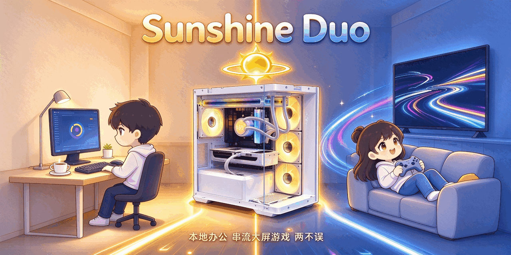

<div align="center">



**一台电脑，当两台用 —— 打游戏的打游戏，办公的办公，互不打扰。**

<br/>

<a href="https://github.com/xRetia/Sunshine-Duo/archive/refs/heads/main.zip">
  
</a>&nbsp;
<a href="https://gh-proxy.com/https://github.com/xRetia/Sunshine-Duo/archive/refs/heads/main.zip">
  
</a>&nbsp;
<a href="https://github.com/Axixi2233/moonlight-android/releases/latest">
  
</a>

<br/>

<a href="https://cdn.jsdelivr.net/gh/xRetia/Sunshine-Duo@main/assets/sunshine-duo-video.html" title="浏览器直接播放，无需任何插件">
  
</a>&nbsp;
<a href="https://fastly.jsdelivr.net/gh/xRetia/Sunshine-Duo@main/assets/sunshine-duo-video.html">
  
</a>

<br/>

<sub>视频为纯浏览器实时渲染（Canvas 画面 + 合成音乐 + 中文配音），无需插件；离线观看：下载 ZIP 后双击 <code>assets\sunshine-duo-video.html</code> 即可</sub>

<br/>

<sub>备用镜像：<a href="https://ghfast.top/https://github.com/xRetia/Sunshine-Duo/archive/refs/heads/main.zip">ghfast.top</a>　·　iOS / 电视 / PC 端请用官方 <a href="https://moonlight-stream.org">Moonlight</a>，功能完全兼容</sub>

<br/>

<a href="https://github.com/xRetia/Sunshine-Duo/blob/main/LICENSE"></a>&nbsp;
&nbsp;


</div>

---

## 🛡️ 杀毒软件报毒？先别慌，这不是黑客工具

本工具为了实现「断开后游戏画面不掉线」「手柄即插即用」这些体验，需要安装**后台服务、虚拟手柄驱动、远程会话组件**——这些行为特征和某些远程管理工具很像，**部分杀毒软件可能误报**。

- ✅ 全部源码开放（GPL-3.0），每一行都能自己审
- ✅ 核心组件都是知名开源项目：Apollo、RDP Wrapper、ViGEmBus、SudoVDA（见[开源许可](#️-开源许可)）
- ✅ 不碰你的隐私、不开后门、不联网上传任何东西

**遇到拦截怎么办**：把解压出来的整个文件夹加入杀毒软件的**信任区 / 白名单**（Windows Defender → 病毒和威胁防护 → 允许的威胁；其他杀软类似），然后重新运行 `setup.bat` 就行。

## 🎮 一台电脑，当两台用

普通串流：你一开始打游戏，家里用电脑的人就被“挤下线”。
**Sunshine-Duo**：两个会话同时在线，各玩各的。

| | 🖥️ Console 会话 | 🕹️ 游戏会话 |
| --- | --- | --- |
| 谁在用 | 本机键鼠 / UU 远程 | Moonlight 客户端（手机/平板/电视/PC） |
| 看哪块屏 | 物理显示器 | 独立虚拟屏（分辨率自己定） |
| 输入设备 | 本机键鼠 | 串流手柄，虚拟成 Xbox 360 手柄 |
| 互相干扰 | ❌ 完全隔离 | ❌ 完全隔离 |

**典型场景**：你在书房写文档查资料，家人在客厅用电视连着手柄打《原神》——同一台电脑、同一个系统，两边同时进行，谁也踢不掉谁。

## ✨ 亮点

| 亮点 | 说明 |
| --- | --- |
| 👥 **双会话隔离** | 键鼠、手柄、画面、声音各归各的会话，不打架、不抢焦点 |
| 🤝 **与网易 UU 远程兼容** | UU 远程管 console 会话做日常远控，Sunshine-Duo 管游戏会话；两边可同时连一台机器，互不冲突 |
| 🎮 **手柄即插即用** | 串流手柄虚拟成 Xbox 360 手柄——兼容性最好的一档，支持多手柄，还不影响本机键鼠 |
| 🔐 **能启动要管理员权限的游戏** | 自带游戏菜单（GameManager），串流端直接开游戏，不用先跑回电脑前点 UAC |
| 🌙 **断流不掉屏** | 断开串流后虚拟屏自动保活，下次连接即开即用，不用重新拉起 |
| 🧰 **一键安装卸载** | 图形界面，全中文；整个目录可任意移动，卸载不删配置和已配对设备 |

## 🚀 三步开玩

> ⚠️ **安装前先做一件事：暂时关闭杀毒软件**（或直接把解压出的文件夹加入信任区 / 白名单）。原因见上方蓝底说明——装后台服务、驱动这些行为容易被误报拦截，导致安装失败。装完后可以再打开。

1. **解压并安装**——解压到任意目录（D 盘 E 盘都行），双击 **`setup.bat`**；弹出蓝色 UAC 授权窗口时点 **「是」**（安装需要管理员权限，不点它没法装服务、驱动和防火墙规则）
2. **按向导走完三步**——选串流用的显卡 → 输入电脑登录密码 → 勾选可选功能，点「开始安装」等完成
3. **手机装客户端，连上开玩**——安卓手机推荐上面的 **阿西西月光**（Moonlight 汉化增强版）；iPhone / iPad / 电视 / PC 用官方 [Moonlight](https://moonlight-stream.org)。同一 WiFi 下客户端会自动发现主机，输入主机网页显示的 4 位配对码即可连接 🎉

> 💡 **第一次用**：安装完建议先用 Moonlight 串流进去确认一切正常，再把游戏快捷方式放进 `Links\` 文件夹，之后从游戏菜单一键启动。

## 📱 手机党看这里：配个手柄，掌机体验直接拉满

手机触屏玩 PC 游戏，虚拟摇杆总差点意思。**蓝牙手柄 + 手机支架 = 一台随时可开的"掌机"**：

- ✅ **兼容性好**：主机把手柄虚拟成 Xbox 360 手柄，游戏直接识别，不用折腾映射
- ✅ **推荐手柄**：Xbox 无线手柄、飞智黑武士、北通系列、8BitDo……只要是蓝牙手柄基本都行
- ✅ **姿势随意**：躺床上、靠沙发、蹲马桶，手机往支架上一夹，比端着电脑舒服多了
- ✅ **网络小技巧**：手机连 5GHz WiFi；追求极限低延迟可以用 USB 数据线共享网络给手机，接近有线体验

## 📁 里面有什么

| 目录 / 文件 | 是干嘛的 |
| --- | --- |
| `setup.bat` | 一键安装入口（双击它） |
| `sunshine.exe` | Sunshine 本体（Apollo） |
| `tools\` | RDP 解锁、游戏菜单等工具 |
| `wsguard\` | 串流会话守护服务（保活虚拟屏、自动拉起） |
| `drivers\` | 虚拟显示驱动 |
| `Links\` | 🎮 放你的游戏快捷方式，串流端一键启动 |
| `assets\` | 资源图片与项目介绍视频（`sunshine-duo-video.html`） |

<details>
<summary><b>🔧 进阶：重新打包 wsguard</b>（一般用不着）</summary>

需要 **Python 3.12（x64）与 pip**。构建依赖不随仓库分发，首次构建自动 pip 安装到 `.wsguard-build\`：

```powershell
cd wsguard\src
powershell -NoProfile -ExecutionPolicy Bypass -File .\build.ps1 -Deploy
```

依赖清单：`wsguard\src\requirements-build.txt`（PyInstaller 工具链）、`requirements-rdp.txt`（aardwolf RDP 运行库）。

</details>

<details>
<summary><b>✅ 自检</b>（不想装的时候可以先跑这个看看环境）</summary>

```powershell
powershell -NoProfile -ExecutionPolicy Bypass -STA -File scripts\sunshine-setup.ps1 -SelfTest
```

不做任何系统变更，只验证路径、显卡识别、界面、加解密是否正常。

</details>

## ⚖️ 开源许可

本仓库自有代码（安装脚本、wsguard、GameManager 等）以 **GPL-3.0** 授权，全文见 [LICENSE](LICENSE)。

仓库内捆绑的第三方组件各自保留原始许可证：

| 组件 | 项目地址 | 许可证 |
| --- | --- | --- |
| Apollo（sunshine.exe 及附属工具） | https://github.com/ClassicOldSong/Apollo | GPL-3.0 |
| RDP Wrapper | https://github.com/stascorp/rdpwrap | Apache-2.0 |
| GameManager | https://github.com/xRetia/game-manager | GPL-3.0 |
| ViGEmBus 驱动 | https://github.com/nefarius/ViGEmBus | BSD-3-Clause |
| SudoVDA 虚拟显示驱动 | https://github.com/SudoMaker/SudoVDA | MIT |
| nefcon | https://github.com/nefarius/nefcon | MIT |
| zlib | https://zlib.net | zlib License |
| wsguard 的 Python 依赖（aardwolf 等） | https://pypi.org（清单见 wsguard\src\requirements-rdp.txt） | MIT / BSD / Apache-2.0 / MPL-2.0 / PSF 等 |

完整清单、版本号与许可证全文见 [THIRD-PARTY-NOTICES.md](THIRD-PARTY-NOTICES.md) 与 [licenses\](licenses) 目录。
